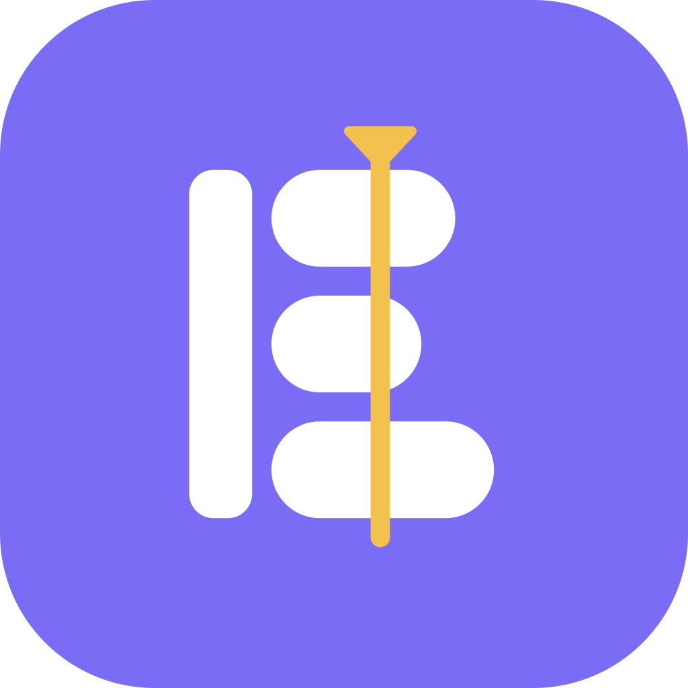

<p align="center">
  
</p>

<h1 align="center">Bravin</h1>

<p align="center"><b>Dựng video trên trình duyệt, Android và Windows.</b><br>
Tối ưu cho video dọc TikTok / Reels / Shorts, nhưng có công cụ của phần mềm chuyên nghiệp.</p>

<p align="center">
  <a href="https://bravin.vtvcab17.workers.dev/"><b>🎬 Mở Bravin trên web</b></a> ·
  <a href="https://bravinall.vtvcab17.workers.dev/bravin.html">Trang giới thiệu</a>
</p>

---

## Mục lục

- [Tính năng](#tính-năng)
- [Chạy thử](#chạy-thử)
- [Cấu trúc thư mục](#cấu-trúc-thư-mục)
- [Kiểm thử](#kiểm-thử)
- [Đưa lên web](#đưa-lên-web)
- [Ghi chú cho người phát triển](#ghi-chú-cho-người-phát-triển)
- [Hệ sinh thái Bravinall](#hệ-sinh-thái-bravinall)

## Tính năng

**✂️ Dựng**
- Timeline nhiều track kiểu CapCut / Premiere: ripple, roll, slip, slide, rate stretch, In/Out, chọn nhiều clip, menu chuột phải.
- Bố cục bảng làm việc co giãn, hỗ trợ nhiều màn hình.
- Keyframe và Effect Controls kiểu Premiere, speed ramp.
- Công cụ Bút (P): vẽ hình, mask bezier, chấm key độ mờ / âm lượng ngay trên timeline.

**🎨 Màu và hình ảnh**
- Lumetri Color, LUT `.cube`, scopes.
- Trang chỉnh màu kiểu DaVinci: bảng node dạng canvas (nối tiếp, song song, lớp, ngoài vùng).
- Mask elip, chữ nhật, bút bezier, theo dõi chuyển động; tách nền xanh, tách người.
- Hiệu ứng, chuyển cảnh, gói kiểu Sapphire; khử nhiễu, chống nhấp nháy, ổn định hình, slow-motion mượt, làm mịn da, giả lập phim.

**🔊 Âm thanh**
- Chuẩn LUFS, khử ồn, ducking, đồng bộ âm thanh theo sóng.

**🤖 AI**
- Trợ lý AI: Claude trên claude.ai, hoặc **Luồng AI** dạng canvas (node AI, điều kiện, gộp, lặp…).
- Kết nối API chỉ cần dán mã, AI local qua đường link, hoặc model nhúng chạy ngay trong ứng dụng.
- **Phim AI (4.10)**: nhúng LocalMiniDrama tiếng Việt (MIT © xuanyustudio) để AI viết kịch bản → phân cảnh → ảnh → video. Tệp tạo xong tự vào thư viện; nút ＋ Dự án tạo dự án cùng tên phim.

**📤 Xuất**
- MP4 bằng WebCodecs, phụ đề SRT, FCP XML.

**📱 Bravin cho Samsung (4.11)**
- APK riêng `app.bravin.samsung`: vẽ tay S Pen theo lực nhấn, Air View, Air actions, tự nhận Samsung DeX.
- Trên mọi bản Android, cài plugin cần dùng bản máy tính.

<details>
<summary><b>Tài liệu chi tiết từng tính năng</b></summary>

| Chủ đề | Tài liệu |
|---|---|
| Kiến trúc và từng nhóm tính năng | `docs/ARCHITECTURE.md` |
| Định dạng dự án | `docs/BRAVIN_PROJECT_FORMAT.md` |
| Viết plugin | `docs/PLUGIN_SDK.md` |
| Phim AI | Hướng dẫn: `app/huong-dan/phim-ai.html` (trên web: `/huong-dan/phim-ai.html`) · Kỹ thuật: `docs/PHIM_AI_LOCALMINIDRAMA.md` · Bộ cài Windows (có sẵn Node.js và ffmpeg): `downloads/PhimAI_Setup_1.2.8.exe`, cách dựng ở `tools/phimai-installer/` · Mã nguồn macOS/Linux: `app/downloads/` |
| Samsung | Hướng dẫn: `app/huong-dan/samsung.html` · Kỹ thuật: `docs/SAMSUNG.md` |
| Nộp Google Play / Galaxy Store | `docs/STORE.md`, hồ sơ cửa hàng `play/` |

</details>

## Chạy thử

**Bản web** (HTML/CSS/JS thuần, không cần build):

```bash
cd app
python3 -m http.server 8080     # hoặc: node ../tests/serve_static.js . 8080
# mở http://localhost:8080
```

**Windows:** mở thư mục `desktop/` và làm theo `HUONG_DAN.txt`.

> [!IMPORTANT]
> Sửa `app/` xong thì dựng lại bản Windows: `python3 tools/make_desktop_app.py .`
> (thay Google Fonts bằng phông chữ cục bộ, bỏ `downloads/`).

## Cấu trúc thư mục

| Thư mục | Nội dung |
|---|---|
| `app/` | Ứng dụng web hiện tại. `vendor/transformers/` là bộ chạy AI nhúng |
| `desktop/` | Bản Windows: `Cai dat Bravin.bat` (tạo biểu tượng Desktop / Start Menu), `Mo Bravin.bat` (chạy không cần cài). `bravin.ps1` là máy chủ nội bộ mở Bravin trong cửa sổ riêng của Edge/Chrome; `app/` là bản chạy không cần mạng |
| `android/` | Dự án Android (WebView), `www/` là ứng dụng. `build.sh` dựng AAB (Google Play) và APK, target API 36 (đặt biến `KS_PASS` là mật khẩu keystore) |
| `tools/` | Script dựng bản web/PWA, logo, `package.json` các thư viện gốc |
| `docs/` | Tài liệu kỹ thuật, tài sản logo |
| `legacy/` | Các phiên bản cũ: trình dựng đầu tiên (`editor/`), bản chạy cục bộ VINCut, dự án Android cũ |
| `tests/` | Kiểm thử Playwright (Chromium headless) và máy chủ tĩnh `serve_static.js` |

## Kiểm thử

```bash
npm i -g playwright
node tests/serve_static.js app 8772 &
node tests/fix4.js    # ví dụ: đồng bộ âm thanh (không cần video mẫu)
```

Phần lớn kịch bản kiểm thử cần một dự án mẫu: đặt `project.json` cùng video của bạn cạnh `index.html`.

## Đưa lên web

Bản web chạy trên Cloudflare Workers. `wrangler.jsonc` ở thư mục gốc trỏ tới `./app`.

| Cài đặt build trên Cloudflare | Giá trị |
|---|---|
| Build command | để trống |
| Deploy command | `npx wrangler deploy` |
| Root directory | `/` |

> [!WARNING]
> Mỗi tệp tĩnh phải **nhỏ hơn 25 MiB**. Tệp lớn nhất hiện tại là `ort-wasm…wasm` ≈ 20,6 MiB.

## Ghi chú cho người phát triển

- Mã định danh nội bộ giữ tên cũ để tương thích dữ liệu: IndexedDB `vincut`, localStorage `vincut-*`, định dạng dự án `vincut`, `window.VINCutAndroid`, package Java `app.vincut`. Gói cài đặt từ 4.11 bản 19 là `app.bravin`.
- Khoá ký APK (`*.jks`) bị loại khỏi git bằng `.gitignore`; hãy giữ một bản sao an toàn riêng.
- Repo không kèm video hay dự án mẫu. Nút **Dự án mẫu** ở màn hình chính chỉ hiện khi có `project.json` cạnh ứng dụng.

## Hệ sinh thái Bravinall

| Ứng dụng | Dùng để | Gửi gì sang Bravin |
|---|---|---|
| [Antifact](https://github.com/vtvcab17-max/Antiface) | Thiết kế, chỉnh ảnh | Thiết kế, mỗi layer một track |
| [Micron](https://github.com/vtvcab17-max/micron) | Canvas AI, chợ plugin | Ảnh, giọng đọc, video; plugin chạy trong Bravin |
| [Micow](https://github.com/vtvcab17-max/Micow) | Làm nhạc trên máy | Lời `.lrc`, dự án `.bravin.json` 9:16 |

---

<p align="center">© 2026 Phạm Việt Hà · <a href="https://bravinall.vtvcab17.workers.dev/">Bravinall</a></p>
